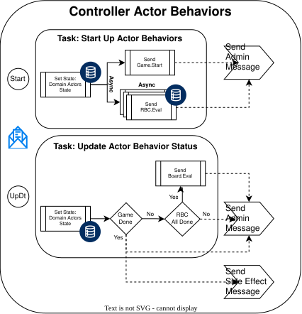
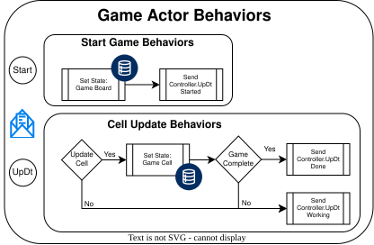
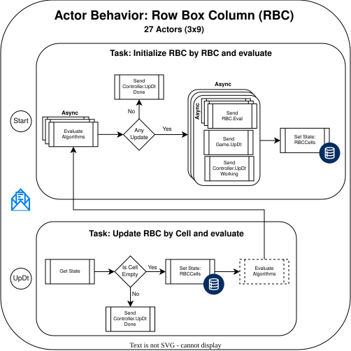
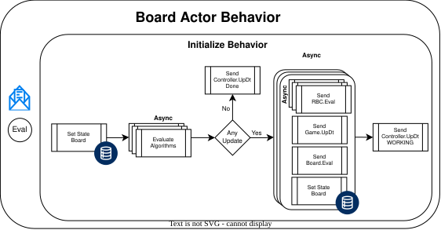

## Summary

Demonstrate the actor model by implementing domain logic to solve sudoku puzzles.

## Actors

### Controller

#### Description

The Controller manages the domain actor's lifecycle. Receives update messages from domain actors and pushes them to the framework administrator.

#### Message Spec

- Start-up set game and rbc state via actors
  - send game start message
  - send rbc start mmessage
- Update Domain Actor Status
  - if board status is done finish via side effect actor
  - if all RBC are done execute board actor

#### Static info

- List of actors with attributes and the associated cell id's for RBC actors

### Game

#### Description

The Game actor manages the game lifecycle.

#### Message Spec

- Start - set game state by board
  - send controller status message
- Update - Update board by cell and evaluate state
  - send controller status message

### RBC

#### Description

The RBC actor manages one row, box, or column set.

#### Message Spec

- Init set state for all cells and evalute all aglorithms
  - send game update if cell value changed
  - send other assoicated RBC updates if cell value changed
  - send controller status message
- Update by Cell if not already populated and evalute all aglorithms
  - send game update if cell value changed
  - send other assoicated RBC updates if cell value changed
  - send controller status message

#### Algorithms

- Naked Single
- Hidden Single
- Naked Pair
- Hidden Pair
- Naked Triple
- Hidden Triple

#### Static info

- cells with their assocaited RBC Actors

### Board

#### Description

The Board actor manages the board and runs algorithms that require board-level visibility.

#### Message Spec

- Evaluate - get fresh board state everytime and evaluate algorightms
  - send game update if cell value changed
  - send other assoicated RBC updates if cell value changed
  - send controller status message

#### Algorithms

- X-Wing
- Swordfish
- Jellyfish
- YWing
- XYZ-Wing
- Simple Coloring
- Multi-Coloring
- XY-Chain
- Forcing Chains
- Unique Rectangle
- Pointing Pair / Pointing Triple
- Box-Line Reduction

#### Static info

- cells with their assocaited RBC Actors
